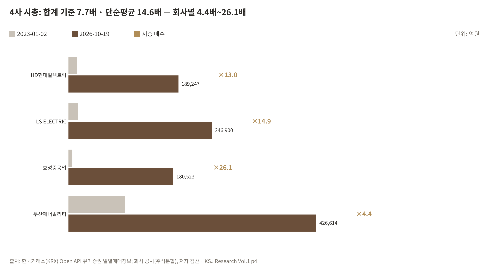
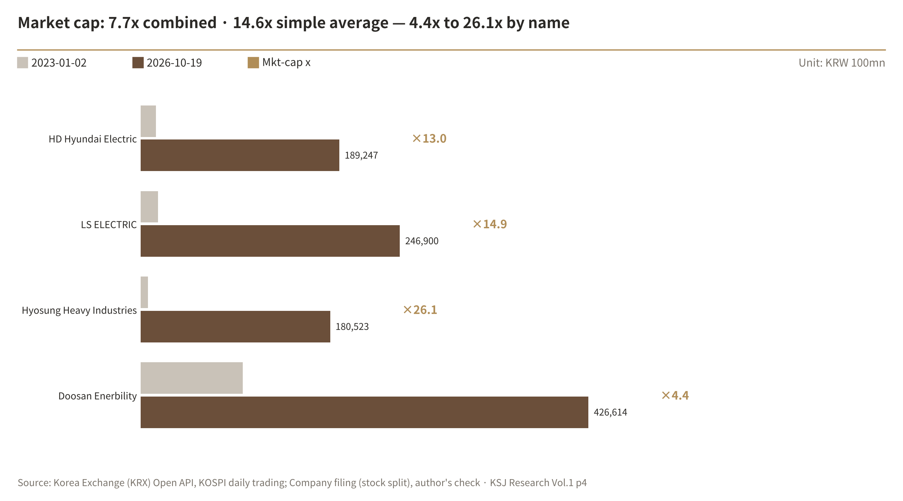

# 강신재 AI 에너지 자산 포트폴리오 | KSJ AI Energy Asset Portfolio

> **핵심 질문: AI 데이터센터 전력 수요는 진짜인가, 그리고 주식시장은 그것을 이미 가격에 반영했나?**
>
> 기준일 2026-10-20 · 저자 강신재(Shinjae Kang) · 교육·연구 목적, 투자 권유 아님 · [English below](#english)

## 핵심 발견 (Vol.1)

아래 세 줄은 보고서 빌드 때 공식 출처 데이터에서 다시 계산해 채워집니다.

<!-- vol01:findings:kr -->
1. **수요는 진짜다 — 2030년 945TWh, AI 데이터센터 수요 +50%**<br><sub>데이터센터 전력 소비 2030E ÷ 2024 (IEA 기준 시나리오): 2.3배</sub>
2. **현장에서도 보인다 — 미국 전체(+10%)를 지수 63포인트 앞섰다**<br><sub>버지니아 상업용 전력 판매 2015→2025 (EIA): +73%</sub>
3. **시장은 이미 알고 있다 — 4사 중 4곳은 시총이 이익보다 빠르게 늘었다**<br><sub>4사 시총 합계 기준, 2023-01-02→2026-10-19 (회사별 4.4배~26.1배): 7.7배</sub>
<!-- /vol01:findings:kr -->



<sub>Vol.1 4쪽 "시장" 대표 Exhibit — 그림은 빌드 때 데이터에서 다시 그려집니다.</sub>

## Research Notes

| Vol | 제목 | 날짜 | 국문 | English |
|---|---|---|---|---|
| 1 | AI 전력 수요는 진짜인가, 시장은 이미 알고 있나 | 2026.10 | [PDF](research/vol01/KSJ_Research_Vol01_KR.pdf) | [PDF](research/vol01/KSJ_Research_Vol01_EN.pdf) |
| 2 | 멀티플이 높아진 섹터의 IPO 공모가 — 가상 기업 Target Co. 희망공모가 밴드 | 예정 | — | — |
| 3 | 해외 피어 비교 | 예정 | — | — |

## 분석 방법

1. **수집** — IEA·EIA·DART·KRX·한국은행 ECOS·FRED 등 공식 출처 데이터만 사용하고, 모든 수치에 출처와 기준일을 적습니다.
2. **검증** — 시가총액 = 종가 × 상장주식수 검산, 액면분할 대조(LS ELECTRIC 2026-04-13 5:1), 종목 식별자 확인.
3. **계산** — Δln(시총) = Δln(지배순이익) + Δln(PER) 로그 분해로 시총 증가를 이익과 멀티플로 나누고, 국문·영문 보고서로 정리합니다.

구현: AI 코딩 도구(Claude Code)로 데이터 수집·계산·보고서 생성 코드를 작성. 질문 설계, 분석 범위 결정, 숫자 검증은 저자.

<details>
<summary><b>재현 방법</b></summary>

```powershell
git clone https://github.com/Cojae-Kang/ksj-ai-energy-asset-portfolio.git
cd ksj-ai-energy-asset-portfolio
python -m venv .venv
.venv\Scripts\Activate.ps1
pip install -r requirements.txt
copy .env.example .env                                              # API 키 입력 (.env는 커밋되지 않음)
python -m src.data_fetch.fetch_all --source all --asof 2026-10-20   # 공식 출처 데이터 수집
python -m research.vol01.fetch_extra --asof 2026-10-20              # Vol.1 추가 데이터
python -m research.vol01.build                                      # 국문·영문 PDF + README 핵심 발견·그림 갱신
pytest -q                                                           # 네트워크 없이 도는 테스트
```

데이터 소스별 수집 내용, 폴더 구조, 타임아웃·검증 규칙은 [docs/data_pipeline.md](docs/data_pipeline.md), 수집 요약과 교차검증 기록은 [docs/qa/](docs/qa/)에 있습니다.

</details>

## 데이터 출처와 이용 조건

| 출처 | 제공기관 | 사용 데이터 | 이용 조건 |
|---|---|---|---|
| IEA | International Energy Agency | *Energy and AI* (2025.4), *Key Questions on Energy and AI* (2026.4) 요약 수치 | CC BY 4.0, 출처 표기 (© IEA) |
| EIA | U.S. Energy Information Administration | 미국 주별·부문별 전력 소매판매량 | 미국 정부 공개 데이터, 출처 표기 |
| KRX | 한국거래소 | 종가, 시가총액, 상장주식수 | KRX 정보데이터시스템·Open API 이용약관, 출처 표기 |
| DART | 금융감독원 | 사업보고서 연결 재무제표 | Open DART 이용약관, 출처 표기 |
| ECOS | 한국은행 | 원/달러 환율, 국고채 금리 | 한국은행 ECOS 이용약관, 출처 표기 |
| FRED | Federal Reserve Bank of St. Louis | 미 국채 10년 금리 | FRED 이용약관, 출처 표기 |

- 원자료(API 응답 원본)는 저장소에 올리지 않고, 가공 데이터와 출처·기준일만 공개합니다.
- 코드: [MIT License](LICENSE) · 폰트: Noto Sans KR (SIL Open Font License 1.1, `assets/fonts/`)

## 면책

이 저장소는 교육·연구 목적의 개인 포트폴리오이며 투자 권유가 아닙니다. 본문의 판단은 저자 개인의 견해입니다.
분석 대상 "Target Co."는 가상 기업으로 실존 기업과 관련이 없습니다. 공개 자료를 사용했으나 정확성과 완전성을 보장하지 않으며,
이 자료를 근거로 한 투자 판단의 책임은 투자자 본인에게 있습니다.

---

<a id="english"></a>

## English

> **Core question: Is AI data-centre power demand real — and has the stock market already priced it in?**
>
> As of 2026-10-20 · Author: Shinjae Kang · For education and research only; not investment advice

### Key findings (Vol.1)

Recalculated from official-source data each time the report is built.

<!-- vol01:findings:en -->
1. **Demand is real — 945 TWh by 2030; AI data-centre demand +50%**<br><sub>Data-centre power 2030E ÷ 2024 (IEA Base Case): 2.3x</sub>
2. **It shows up on the ground — 63 index points ahead of the U.S. (+10%)**<br><sub>Virginia commercial power sales 2015→2025 (EIA): +73%</sub>
3. **The market already knows — for 4 of 4, market cap outgrew earnings**<br><sub>4 names, combined cap, 2023-01-02→2026-10-19 (range 4.4x–26.1x): 7.7x</sub>
<!-- /vol01:findings:en -->



<sub>Vol.1 page 4 "Market" representative exhibit — redrawn from the data at each build.</sub>

### Research Notes

| Vol | Title | Date | Korean | English |
|---|---|---|---|---|
| 1 | Is AI Power Demand Real, and Does the Market Already Know? | 2026.10 | [PDF](research/vol01/KSJ_Research_Vol01_KR.pdf) | [PDF](research/vol01/KSJ_Research_Vol01_EN.pdf) |
| 2 | IPO pricing in a re-rated sector — indicative price range for a hypothetical Target Co. | Planned | — | — |
| 3 | Overseas peer comparison | Planned | — | — |

### Methodology

1. **Collect** — official sources only (IEA, EIA, DART, KRX, Bank of Korea ECOS, FRED), each figure with its source and as-of date.
2. **Validate** — market cap = close × listed shares, stock-split check (LS ELECTRIC 5:1 on 2026-04-13), identifier check.
3. **Calculate** — split the market-cap gain into earnings and multiple with Δln(cap) = Δln(NI) + Δln(P/E), then publish Korean and English reports.

Built with an AI coding tool (Claude Code); question design, scope decisions and number verification by the author.

<details>
<summary><b>How to reproduce</b></summary>

See the commands in the Korean section above and [docs/data_pipeline.md](docs/data_pipeline.md) (Korean). API keys are read from `.env` only and are never committed.

</details>

### Data sources and terms

IEA (CC BY 4.0, © IEA) · U.S. EIA (U.S. government data) · KRX · DART (Financial Supervisory Service) · Bank of Korea ECOS · FRED (Federal Reserve Bank of St. Louis). Each is used with attribution under its provider's terms; raw API responses are not redistributed. Code under the [MIT License](LICENSE); fonts under the SIL Open Font License 1.1.

### Disclaimer

Personal portfolio for education and research; not investment advice. Judgements are the author's own. "Target Co." is hypothetical and unrelated to any real company. Public data are used without any guarantee of accuracy or completeness.
